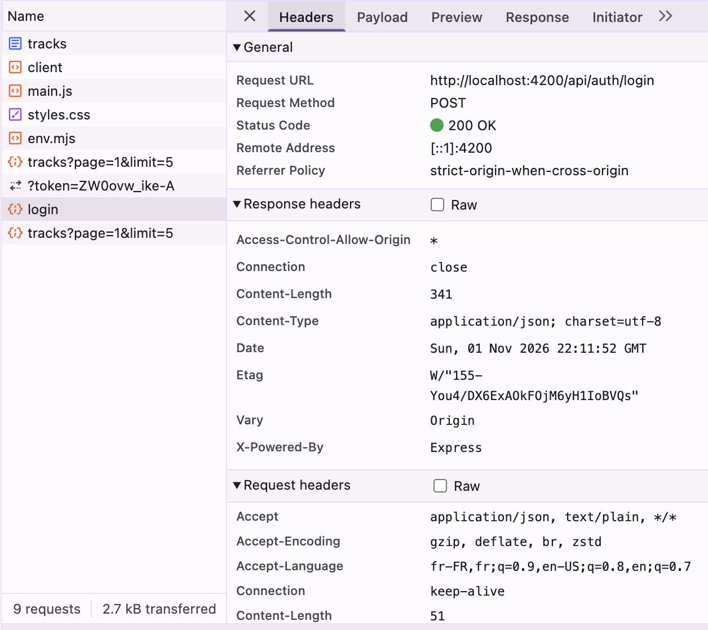
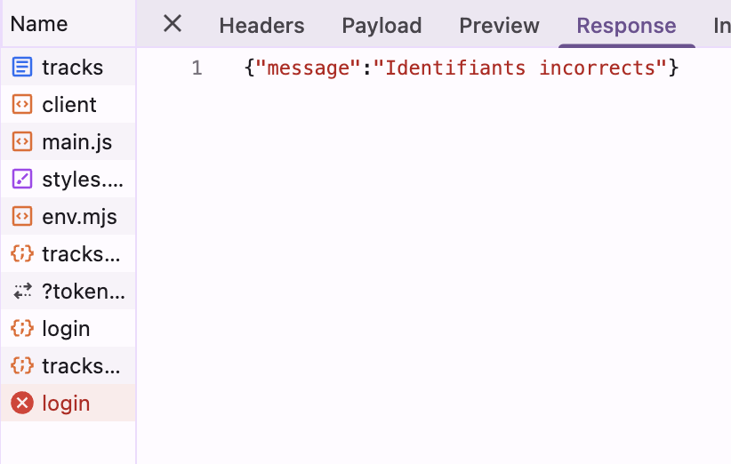
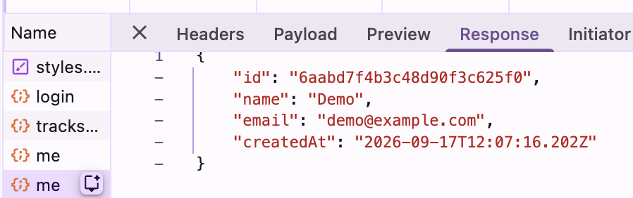

# Rapport d'usage de l'IA - TP1

Pour chaque mission, détailler et fournir des explications concernant : objectif; prompt principal; plan proposé par l'agent; vérifications réalisées par le binôme; erreurs ou propositions rejetées; fichiers effectivement modifiés; preuve de fonctionnement; ce que chaque membre sait maintenant expliquer sans l'agent.

**Assistant utilisé :** Claude Sonnet 5, via Claude Code (extension intégrée à l'éditeur).
**Travail réalisé en solo** (changement en cours de séance, initialement prévu en binôme).

## Explication : Signal vs `localStorage`

Un **Signal** Angular (`signal<T>()`) est une valeur réactive en mémoire : quand on appelle `.set()` ou `.update()`, tous les templates et calculs qui lisent ce signal (via `signal()`) se remettent à jour automatiquement, sans rechargement de page. Dans `AuthService`, `currentUser` et `token` sont des signaux : c'est grâce à eux que la navigation (`app.html`) change instantanément entre "Connexion" et "Déconnexion" dès qu'on se connecte, sans code supplémentaire pour rafraîchir la vue.

**`localStorage`** est un stockage clé-valeur per sistant fourni par le navigateur : il survit à un rechargement de page ou à la fermeture de l'onglet, mais il n'est **pas réactif** — lire `localStorage.getItem('gpc_token')` ne déclenche aucune mise à jour de l'interface si la valeur change ailleurs.

**Pourquoi les deux sont nécessaires** : le signal `token` pilote l'UI en temps réel pendant que l'app tourne, mais il est réinitialisé à chaque rechargement de page (perdu en mémoire). `localStorage` sert donc à *retrouver* le token après un rechargement : au démarrage du service (`readonly token = signal<string | null>(localStorage.getItem('gpc_token'))`), on lit `localStorage` une seule fois pour initialiser le signal, puis c'est le signal qui pilote tout le reste pendant la session.

## Mission 0 — Cartographier l'application

- **Objectif :** identifier le composant racine, la configuration des routes, l'enregistrement de `HttpClient`, les modèles/services/pages, et le mécanisme d'ajout du JWT ; produire un schéma annoté du flux de connexion ; distinguer les routes publiques/protégées dans `API_CONTRACT.md`.
- **Prompt principal :** demande de localiser dans le code chacun de ces éléments et de produire un schéma annoté du clic sur « Se connecter ».
- **Plan proposé par l'agent :** lecture directe des fichiers clés (`main.ts`, `routes.ts`, `app.ts`/`app.html`, `auth.interceptor.ts`, `auth.guard.ts`, `auth.service.ts`, `API_CONTRACT.md`) puis synthèse sous forme de réponses ciblées + schéma texte étape par étape du flux HTTP.
- **Vérifications réalisées :** relecture des réponses, comparaison avec les fichiers réels du projet (chemins et numéros de ligne cités vérifiables directement dans l'éditeur).
- **Erreurs ou propositions rejetées :** aucune — mission de lecture seule, pas de code produit.
- **Fichiers effectivement modifiés :** aucun.
- **Preuve de fonctionnement :** non applicable (pas de code) ; schéma annoté reproduit ci-dessous.
- **Ce que je sais maintenant expliquer sans l'agent :**
  - pourquoi `AppComponent` ne contient que le `<router-outlet />` et comment `provideRouter`/`provideHttpClient` sont déclarés dans `main.ts` (approche standalone, sans `NgModule`) ;
  - comment `authGuard` bloque la navigation côté client, indépendamment de ce que fait le backend ;
  - comment `authInterceptor` ajoute `Authorization: Bearer <token>` uniquement quand un token existe, et pourquoi `/auth/login` n'a jamais cet en-tête.

### Schéma annoté — flux du clic sur « Se connecter »

```text
[login-page.html]  (ngSubmit)="submit()"
        │  l'utilisateur clique, le formulaire contient {email, password}
        ▼
[login-page.ts] submit()
        │  1. form.getRawValue() → {email, password}
        │  2. appelle auth.login(email, password)   ← le composant n'appelle jamais HttpClient directement
        ▼
[auth.service.ts] login()
        │  this.http.post<AuthResponse>('/api/auth/login', {email, password})
        ▼
[auth.interceptor.ts] authInterceptor
        │  lit AuthService.token() → null (pas encore connecté)
        │  → requête transmise SANS modification (pas d'en-tête Authorization,
        │    cohérent avec /auth/login qui est une route PUBLIQUE)
        ▼
   HttpClient → proxy (proxy.conf.json) → API Express
        │  POST http://localhost:3000/api/auth/login
        ▼
[Backend Express] valide les identifiants, interroge MongoDB via Mongoose,
        │  signe un JWT
        ▼
   200 { token, user }  ──────────────► retour vers Angular
        ▼
[auth.service.ts] .pipe(tap(storeAuthentication))
        │  - localStorage.setItem('gpc_token', token)
        │  - token.set(token)          → signal mis à jour
        │  - currentUser.set(user)     → signal mis à jour
        ▼
[login-page.ts] subscribe.next()
        │  router.navigateByUrl('/tracks')
        ▼
[routes.ts] la route 'tracks' a canActivate: [authGuard]
        │  authGuard lit token() → maintenant défini → navigation autorisée
        ▼
[tracks-page] s'affiche ; tout appel HttpClient suivant (ex. GET /api/tracks)
        repasse par authInterceptor, qui CETTE FOIS attache
        Authorization: Bearer <token>, satisfaisant la route protégée.
```

**Routes publiques (`API_CONTRACT.md`)** : `GET /health`, `POST /auth/register`, `POST /auth/login`.
**Routes protégées** (nécessitent `Authorization: Bearer <token>`) : `GET/PUT /users/me`, `GET/POST /tracks`, `GET /tracks/:id/audio`, `DELETE /tracks/:id` (bonus).

## Mission 1 — Inscription, Connexion et Profil

- **Objectif :** compléter la partie utilisateur du frontend : formulaires réactifs, validations, appels `/api/auth/*` et `/api/users/me`, gestion du signal `currentUser`, déconnexion, gestion du `401`.
- **Prompt principal :** demande d'implémentation guidée, étape par étape, avec commit après chaque étape validée par moi-même.
- **Plan proposé par l'agent (9 étapes, réalisées dans cet ordre) :**
  1. Chargement automatique du profil à l'arrivée sur la page + retour visuel sur l'enregistrement du nom.
  2. Validation du champ nom (page profil) avec message d'erreur et bouton désactivé si invalide.
  3. Validation par champ des formulaires login/register (email, mot de passe, nom).
  4. Bouton de déconnexion + navigation réactive à l'état d'authentification (signal `token`).
  5. Gestion du `401` dans `auth.interceptor.ts` : déconnexion automatique et redirection `/login`, uniquement quand un token avait été envoyé (pour ne pas interférer avec un simple échec de connexion sur `/auth/login`).
  6. Tests manuels du guard : accès direct à une route protégée sans être connectée, et avec un token trafiqué dans `localStorage`.
  7. Vérification Network (captures DevTools) : connexion réussie, connexion refusée, GET/PUT `/api/users/me`.
  8. Rédaction des livrables (ce document).
  9. Parcours d'intégration final de bout en bout.
- **Vérifications réalisées :**
  - Étape 6 testée manuellement par moi : accès direct à `/profile` déconnectée → redirection `/login` ✅ ; token invalide dans `localStorage` → déconnexion automatique et redirection `/login` ✅.
  - Étape 7 :
    - Connexion réussie (`POST /api/auth/login`, `200 OK`, aucun en-tête `Authorization` dans la requête — cohérent avec une route publique) : 
    - Connexion refusée (mauvais mot de passe, `401 {"message":"Identifiants incorrects"}`) : 
    - `GET /api/users/me` (`200`, authentifié via l'en-tête `Authorization: Bearer ...` confirmé visuellement dans l'onglet Headers) : 
  - Chaque étape de code a été vérifiée par compilation (`tsc --noEmit`, `ng build`) avant d'être committée.
- **Erreurs ou propositions rejetées :**
  - En voulant vérifier la compilation (étape 3), une installation `node_modules` corrompue a été découverte (`lib.dom.d.ts` manquant). La première correction (réinstallation partielle de `typescript` seul) a elle-même cassé des dépendances natives de `vite`/`rolldown`, provoquant une erreur `ERR_CONNECTION_REFUSED` au démarrage de `ng serve`. Correction finale : suppression complète de `node_modules`/`package-lock.json`, réinstallation propre, puis autorisation explicite des scripts d'installation natifs nécessaires (`esbuild`, `lmdb`, `@parcel/watcher`, `msgpackr-extract`, `fsevents`) via `npm install-scripts approve`.
  - Une suppression accidentelle (par iCloud, pas par l'agent) des fichiers `song1.mp3`/`song2.mp3` a été repérée dans `git status` et volontairement **non committée**.
- **Fichiers effectivement modifiés :**
  - `frontend-starter/src/app/components/profile-page/profile-page.ts` et `.html`
  - `frontend-starter/src/app/components/login-page/login-page.html`
  - `frontend-starter/src/app/components/register-page/register-page.html`
  - `frontend-starter/src/app/components/app/app.ts` et `.html`
  - `frontend-starter/src/app/shared/interceptors/auth.interceptor.ts`
  - `frontend-starter/src/styles.css`
  - `frontend-starter/package.json`, `frontend-starter/package-lock.json` (réparation de l'environnement)
- **Preuve de fonctionnement :**
  - `npx tsc -p tsconfig.app.json --noEmit` : aucune erreur après chaque étape.
  - `npx ng build` : build de production réussi.
  - Tests manuels du guard (étape 6) : voir ci-dessus.
  - Captures Network de l'étape 7 : voir ci-dessus (`docs/screenshots/`).
- **Ce que je sais maintenant expliquer sans l'agent :**
  - pourquoi le profil se charge dans le `constructor()` du composant (le même pattern que `TracksPageComponent`), et pourquoi ça fonctionne avec `inject()` ;
  - comment afficher une erreur de validation par champ (`control.invalid && control.touched`) sans toucher aux validateurs existants ;
  - pourquoi l'intercepteur ne redirige vers `/login` sur un `401` que si un token avait été envoyé, pour ne pas perturber l'écran de connexion lui-même ;
  - comment diagnostiquer un problème d'environnement npm (ports, `node_modules` corrompu, scripts d'installation bloqués) plutôt que de l'attribuer au code applicatif.
